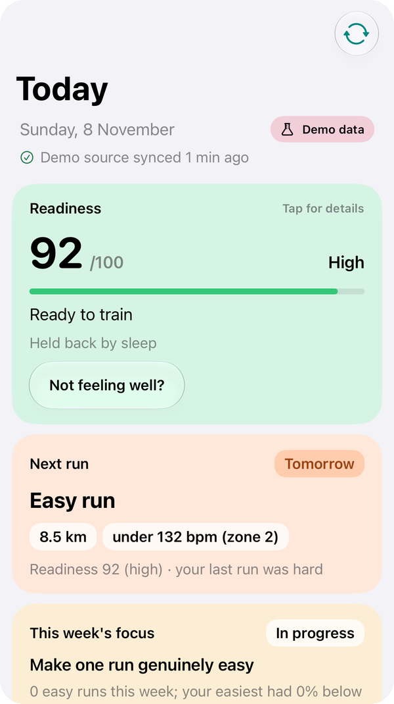
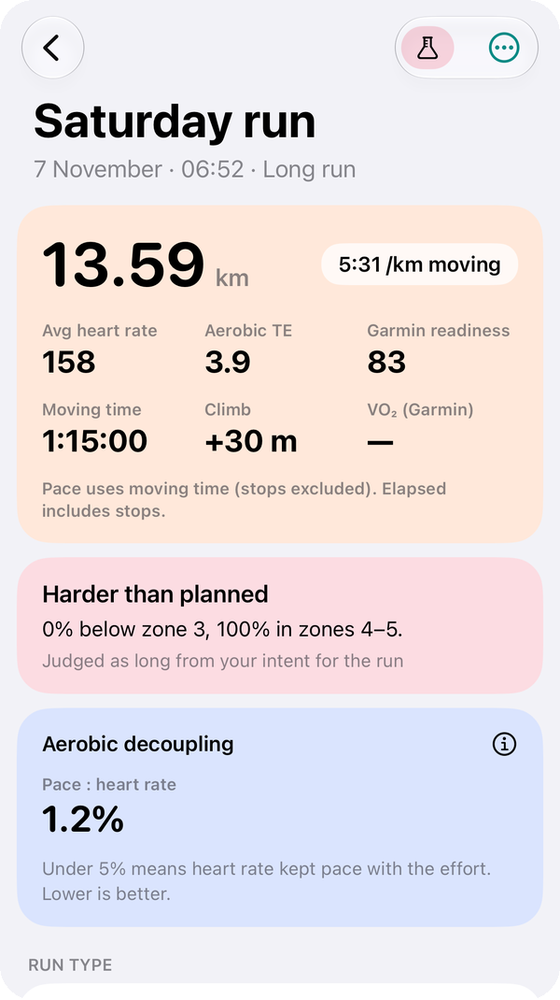
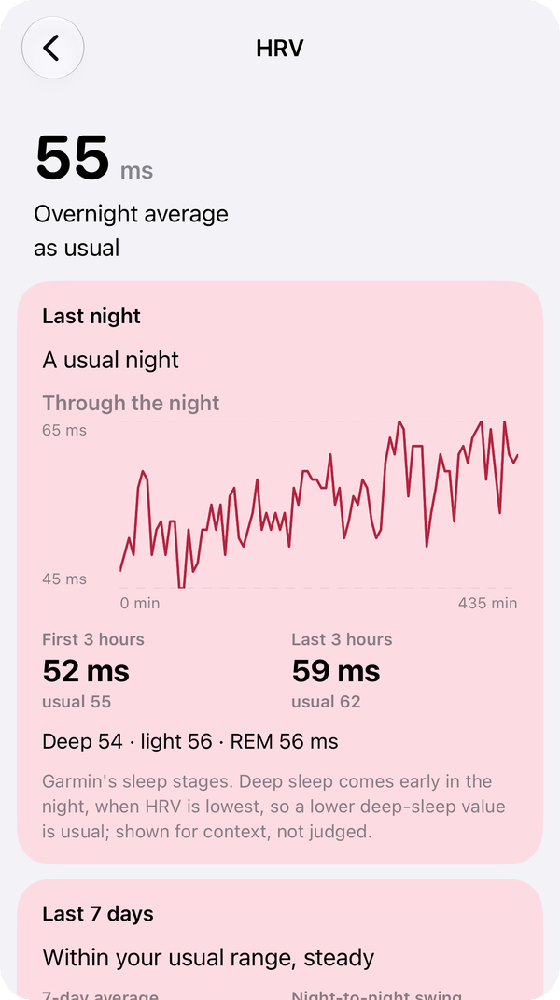
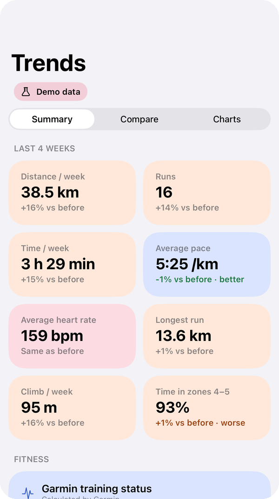

# Runner Sidekick

A running coach on your own data. Runner Sidekick reads your Garmin Connect data (runs, sleep, HRV, resting heart
rate, Body Battery, stress) on a server you run, works out what it means, and shows it in an Android and an iOS app:
a morning briefing and readiness, the next run, each run analysed (hill-adjusted pace, laps, heart-rate drift and
quality, verdict against what it was meant to be), trends, fitness and health scores, VO₂ max estimates, overnight
HRV patterns and, optionally, AI summaries.

Every number says what it is based on and how sure it is. It's a training aid, not medical advice.

iOS app, demo data.

## How it fits together

- **Server** (`backend/`, Python, FastAPI, MongoDB): signs in to Garmin Connect, syncs every hour and does all the
  analysis. Your data stays on your server.
- **Apps** (`app/` Android, Kotlin/Compose; `ios/` iOS, SwiftUI): show what the server works out. In the app you enter
  your server's address and a device token.

Garmin only: other watches aren't supported.

## Run your own server

See [docs/SELF_HOSTING.md](docs/SELF_HOSTING.md) (Docker Compose) or [docs/DEPLOY.md](docs/DEPLOY.md) (plain
systemd + nginx). In short: start it, connect Garmin with `sidekick garmin-login`, create a token with
`sidekick create-token phone`, put it behind HTTPS, and enter the address and token in the app.

## Build the apps

- **Android:** `./gradlew :app:assembleRelease` (Android Studio, JDK 17+).
- **iOS:** `cd ios && xcodegen generate`, open `RunnerSidekick.xcodeproj`, set your own team and bundle identifier in
  `project.yml`, and run on your device (iOS 26).

## Privacy

Your health data lives only on your server. The apps send anonymous usage events (app opened, screens and features
used; never runs, health data or your server's address) to [Aptabase](https://aptabase.com) to help improve the app;
turn it off in Settings under "Share anonymous usage".

## Development

Backend tests need a local MongoDB on `127.0.0.1:27017`:
`cd backend && python -m venv .venv && .venv/bin/pip install -r requirements-dev.txt && .venv/bin/python -m pytest -q`.
How the numbers are worked out: [docs/analysis-rules.md](docs/analysis-rules.md).

## License

[GNU AGPL-3.0](LICENSE). You may use, change and share it; if you run a changed version as a service for others, you
must offer them its source.
